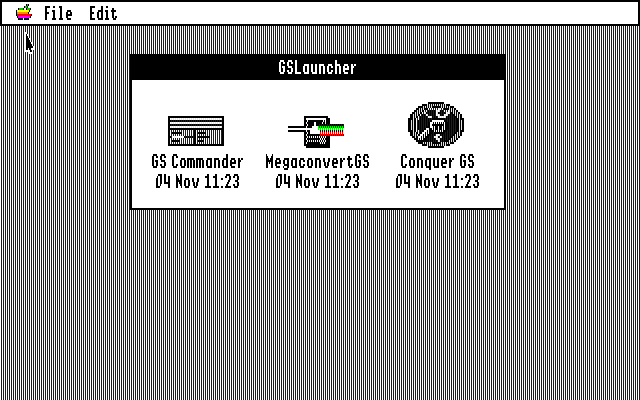

# GSLauncher

A program launcher for the Apple IIgs (GS/OS, System 6).

GSLauncher shows your favourite applications in one small window, each with its Finder icon, its name and the date of the file. Click one and it starts. Quit that program and you are back in the launcher. You can make it the program GS/OS starts at boot, so your applications are one click away without opening the Finder and digging through folders.



## Features

- A window of slots, five to a row, that grows and shrinks to fit. Up to **4 pages** (tabs) of up to 18 slots each.
- Each slot shows the application's **Finder icon**, taken from the Finder's icon files (type $CA). Applications without an icon get a plain one.
- Works with **GS/OS applications (S16)** and **ProDOS 8 applications (SYS)**.
- When an application quits, **you come back to GSLauncher**.
- The **date of the file** is shown under each name, which is handy for seeing that a new build of something you are developing has arrived.
- **Find Apps:** on first start GSLauncher offers to scan your disks (the boot disk or any attached disk) for S16 and ProDOS 8 applications, lists what it finds with check boxes, and adds the ones you check. You can run it again any time from the File menu.
- **Edit the slots in the program:** add an application with the Standard File dialog, change it, rename it, move it left or right, or remove it.
- The slots are kept in a plain text file you can also edit by hand.
- A missing application is shown dimmed with "not found" under it.
- **Quit to Finder** in the File menu goes to the Finder.
- **Keys 1-9** start the first nine slots of the page.
- **Launch count and last used:** GSLauncher counts how often you start each app and when. The **View** menu chooses what the line under each name shows: the file date, when it was last started, or how many times.
- **Restart** and **Shut Down** in the File menu (they use the GS/OS shutdown call, so disks are closed properly).
- **Remove Missing Slots** cleans up slots whose app is gone.
- A **Help menu** explains how to start apps, edit the slots, what each menu entry does, and the slots file.

## Requirements

- An Apple IIgs (or an emulator such as MAME) running **System 6** (GS/OS 6).
- A way to start applications from a disk or hard disk (the Finder's own startup works).

## Installing

### 1. Get GSLauncher onto your IIgs

You need these files, in a folder of their own on your startup disk (for example `GSLauncher`):

| File | Type | Aux type |
| --- | --- | --- |
| `GSLauncher` | S16 ($B3) | $DB03 |
| `Launcher.Slots` (optional) | TXT ($04) | $0000 |

and, if you want its own Finder icon, `GSL.Icons` (type $CA) in an `Icons` folder, either in that folder or at the top of the disk.

**The easy way:** run `./make_disk.sh` (see *Building*). It makes `build/GSLauncher.po`, an 800K ProDOS disk image with everything on it. Mount it in your emulator, or write it to a 3.5" disk, and drag the `GSLauncher` folder onto your startup disk in the Finder.

**With your own tools:** build `build/GSLauncher` and copy it to your IIgs with whatever you use (ADTPro, CiderPress II, Cadius, a network drive ...). It must be a ProDOS file of type $B3 and aux type $DB03. Cadius takes the type from the file name:

```bash
cadius ADDFILE MyDisk.hdv /MYDISK/GSLauncher "build/GSLauncher#B3DB03"
```

### 2. Start it

Open the **GSLauncher** folder in the Finder and double-click GSLauncher. The first time, there is no slots file yet, so **Find Apps** opens and offers to look for your applications (see below).

### 3. (Optional) Start it with the computer

1. Open **Control Panels** in the Apple menu, then **Set Start**.
2. Choose **Select Application** and pick GSLauncher.
3. Restart.

From then on GS/OS starts GSLauncher instead of the Finder. To go back to the Finder for a while, choose **File > Quit to Finder** (Apple-Q). To get the Finder back at start-up for good, set **Start up with: Finder** in Set Start again.

## Using it

- **Find Apps...** (Apple-F): looks for applications on your disks. In the first step you check the disks to look at (the boot disk is checked already; **All** checks every disk). Click **Scan**; Esc stops it. In the second step you check the applications you want and click **Add Selected**. A **scroll bar** beside the list scrolls it: click its arrows or the track, or drag the thumb. The arrow keys scroll too (up and down a row, left and right a page). The System folder and ProDOS itself are left out, and an app that is already in the launcher is not added twice. It finds up to 100 apps.
- **Click a slot** or press its number key (**1-9**) to start the app.
- **Add App...** (Apple-N): pick an application in the dialog (an S16 or a ProDOS 8 SYS file). It goes into the next free slot.
- **Click a slot** to start that application.
- **Edit Slots** (Apple-E): while it is checked, a click picks a slot (a frame goes round it) instead of starting it. The left and right arrow keys pick the neighbour. Escape ends Edit mode. With a slot picked you can use:
  - **Change Slot...**: choose another application for it.
  - **Rename Slot...** (Apple-R): change the name under the icon. Leave it empty to use the file's name again.
  - **Remove Slot**
  - **Move Left / Move Right**

## Pages

With more than one page, tabs show across the top of the window. Click a tab or press **Tab** to change page. The **Page** menu has:

- **New Page...:** a page with a name of your choice (up to 4 pages).
- **Rename Page...**
- **Remove Page:** removes the page and its slots (the apps themselves are not touched).
- **Move Slot to Next Page:** with Edit Slots on and a slot picked, moves it to the end of the next page.

## View

The **View** menu chooses the line under each app's name: **Show File Date**, **Show Last Used** (when you last started it from GSLauncher) or **Show Launch Count**. The choice is kept.

## Restart and Shut Down

**File > Restart...** and **File > Shut Down...** ask first and then use the GS/OS shutdown call, so everything is closed properly. Shut Down shows the "you may now switch off your computer" message, with a Restart button.

## The slots file

The slots are kept in `Launcher.Slots`, a text file in the same folder as GSLauncher. GSLauncher writes it whenever you change the slots or start an app. It has one line per slot, in the form `name=path`:

```
# comments start with # or ;
@view=0
[Work]
Word Processor=*:Apps:Writer:Writer
Paint=*:Apps:Paint:Paint
[Comms]
Terminal=*:Comms:Term.System|12|04 Nov 09:20
```

- `[Name]` starts a page; slots before the first one are on a page called Apps.
- `@view=N` is the View menu's choice (0 file date, 1 last used, 2 launch count).
- `|12|04 Nov 09:20` after a path is the launch count and the time of the last launch. GSLauncher writes it, and you can leave it out.

- A path is an ordinary GS/OS path. A leading `*` stands for the disk you started from (`*:` is the boot volume), so the file keeps working if the disk is renamed.
- If there is no `name=`, the file's name is used (without a trailing `.SYSTEM`).
- Lines can end with CR or LF.
- Without a `Launcher.Slots` file (the first start), GSLauncher opens Find Apps. You can also add applications from the File menu at any time.

## Icons

GSLauncher looks for an application's icon in the Finder's icon files (the files of type $CA, named `...Icons` or `...Icon`):

1. in an `Icons` folder inside the application's own folder, and then
2. in the `Icons` folder at the top of the application's disk.

It uses the first entry whose file type and name match the application. As in the Finder, an entry's name can use `=` as a wildcard, and an entry with no file type matches any type. This is the same way the Finder finds its icons, so an application whose icon shows in the Finder normally shows here too.

To give your own application an icon, ship a Finder icon file with it in an `Icons` folder, as is usual on the IIgs.

## How it starts programs

GSLauncher quits with the GS/OS **Quit** call, giving the application's path and the *return* flag ($8000). GS/OS runs the application and starts GSLauncher again when it quits. Before it quits GSLauncher also:

- turns a leading `*` into the real name of the boot disk, and
- sets the ProDOS 8 prefix to the application's folder, so that ProDOS 8 programs find their data files next to them.

An application that does not return to GS/OS when it quits (for example one that restarts the computer) will not come back to GSLauncher.

## Building

You need [Merlin 32](https://www.brutaldeluxe.fr/products/crossdevtools/merlin/) (the macOS, Linux or Windows version), Python 3 and, for the disk image, [Cadius](https://github.com/digarok/cadius).

```bash
./build.sh        # assembles build/GSLauncher
./make_disk.sh    # build/GSLauncher.po: an 800K disk image with GSLauncher, its read-me and its icon
```

`build.sh` looks for Merlin 32 in `~/Downloads/Merlin32_v1.2_b2/MacOs/Merlin32`. Set `MERLIN32=/path/to/Merlin32` to use another copy. If Merlin reports "Bad Jump", run `test/fixbranches.sh`, which rewrites the branches that are too long.

### Source

| File | What it has |
| --- | --- |
| `src/main.s` | the program: startup, window, menus, slots, icon search, launching |
| `src/equ.s` | macros, tool and GS/OS call numbers, layout constants |
| `src/genicon.s` | the plain icon for applications without one (made by `art/make_icon.py`) |
| `src/link.s` | the Merlin 32 link file |
| `art/make_icon.py` | draws GSLauncher's own Finder icon and the plain icon |

### Testing in MAME

`test/run.sh` boots a System 6 disk image in MAME with GSLauncher in the Finder's place, so it starts as soon as GS/OS has booted. It saves screenshots and can press keys and click with the mouse (`test/dump.lua`). You need MAME with the Apple IIgs ROMs, Cadius and a System 6 disk image:

```bash
BOOT_DISK=/path/to/System6.hdv MAME=/path/to/mame64 ROMS=/path/to/roms test/run.sh
```

- `RUN_SECONDS` sets how long the emulator runs.
- `KEYS` and `SHOTS` press keys, move and click the mouse, and save screens. See the comment at the top of `test/dump.lua` for the syntax.
- `SLOTS=file` uses another slots file, and `SLOTS=none` starts with none.

The screenshots end up in `build/test/screens/`. The script works on a copy of the disk image. `test/run.sh` calls `install.sh`, a helper for the author's own disk layout. Edit it or leave it out when you adapt the harness.

## Limits

- 4 pages of 18 slots, with names of up to 31 characters and paths of up to 254 characters.
- Applications of type S16 and SYS only.
- The window is for the 640-pixel Super Hi-Res desktop (the usual GS/OS desktop).

## License

Copyright 2026 Walter Tengler. All rights reserved unless a license file says otherwise.
